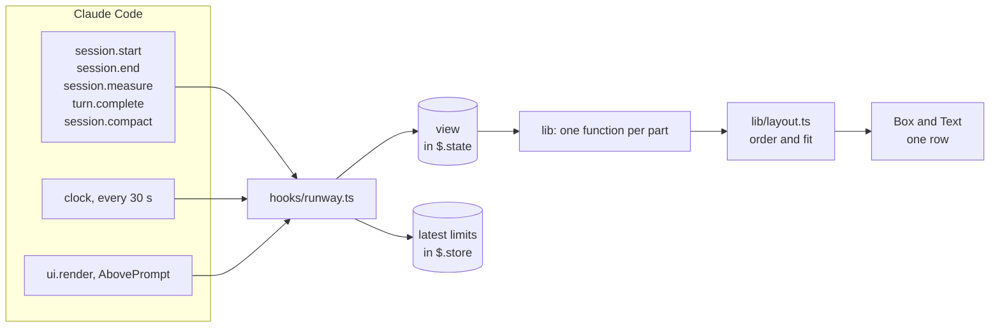
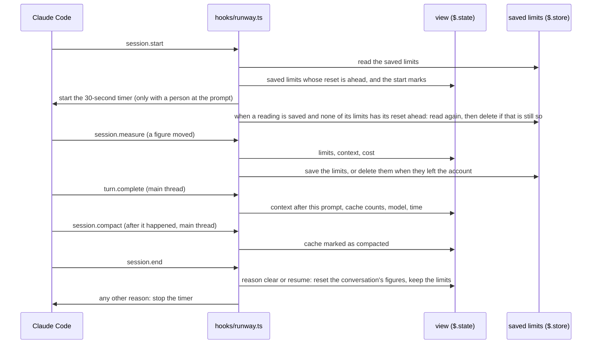
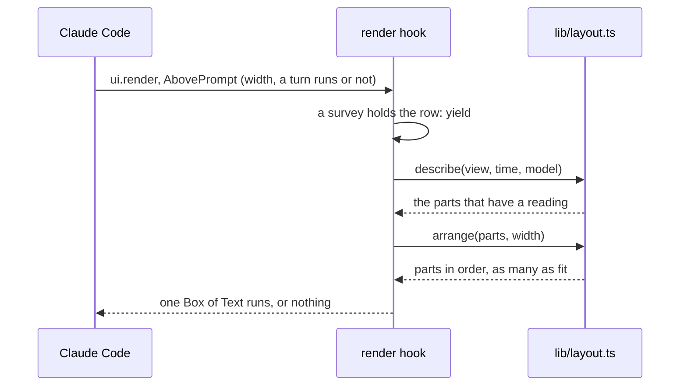

# Architecture

How the mod is built. Paths are relative to `plugins/runway/`. The supported versions and what the
mod keeps are in [configuration.md](configuration.md). How to look after an installed mod is in
[operations.md](operations.md). What each part of the band means is in the
[mod's README](../plugins/runway/README.md).

## Overview

Claude Code loads one hooks module, `hooks/runway.ts`. Its hooks only watch: each one passes its
event on unchanged, except the draw hook, which returns the band's row when the band has a part.
The hooks keep one value, the view of the session, in the state that Claude Code
gives a mod. When Claude Code draws the row above the prompt, the render hook reads the view and
the time, and pure functions turn them into the parts of one row.

## Modules

| File | What it does |
| --- | --- |
| `hooks/runway.ts` | The hooks. It is the only file that calls Claude Code (`$`). It reads the figures, updates the view, starts the 30-second timer and draws the row. |
| `types/index.d.ts` | The state contract: the types of the view. Claude Code checks each state key of the mod against it. The types are written here once, and `lib/view.ts` reads them from here. |
| `hooks/lib/view.ts` | The view and the functions that give a new view after each event: a measure, a turn's end, a compaction, `/clear`, an agents reading, a saved limits reading. |
| `hooks/lib/limits.ts` | The `5h` and `7d` parts: the bar, the time to the reset and the forecast. |
| `hooks/lib/context.ts` | The `ctx` part: the tokens, the share, the chart, the last change and the prompts left. |
| `hooks/lib/cache.ts` | The `cache` part and its states. |
| `hooks/lib/meters.ts` | The cost part and the agents part. |
| `hooks/lib/layout.ts` | Builds every part, orders them by urgency, and drops whole parts until the row fits the width. |
| `hooks/lib/format.ts` | Text for spans of time, token counts and money. |
| `tests/runway.test.ts` | The hooks tests, run by `claude plugin test`. |

The files under `hooks/lib/` are pure. They take the view and the time as arguments and return
data. They do not import from `claude-code`, so `node --test` runs them without Claude Code. Their
tests are in `tests/` at the repo root.

## From an event to the view

- Each hook ends with the result of `next(e)`, with one exception: the draw hook returns its own row
  when the band has a part. The mod changes no event and no other result.
- An absent or wrong context or cost figure keeps the last good one. The band can then show an
  older figure and not an empty part.
- A subagent's turn does not count as a prompt. It changes only the agents count.
- A function in `lib/` that gets an absent or wrong figure returns "no reading". A hook has no
  `try`: if a call on Claude Code fails, Claude Code skips that hook and runs the rest.

## One draw

- The order is alert, then warning, then calm. Inside one state it is `5h`, `7d`, `ctx`, `cache`,
  cost, agents.
- A row that is too wide loses whole parts: the calm ones first, and inside one state agents, cost,
  `cache`, `ctx`, `7d`, `5h`.
- The row uses `Box` and `Text` only, so one tree draws in the terminal, the desktop app and
  VS Code.

## State

The view has a shape tag (`view-2`). When a later version changes the view's fields, it changes the
tag, and Claude Code then gives that version an empty view and not the old one.
