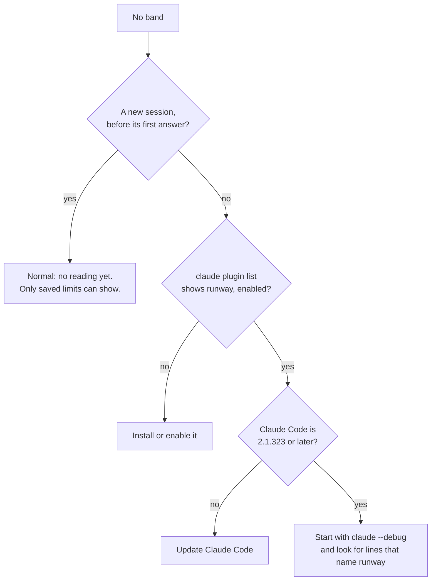

# Operations

How to look after an installed mod: update it, turn it off, and find out why the band does not
show. What the mod keeps is listed in [configuration.md](configuration.md#what-the-mod-keeps).

## Update, turn off, remove

| Purpose | Command |
| --- | --- |
| Update to the newest version | `claude plugin update runway@tmathura-runway` |
| Turn the band off | `claude plugin disable runway@tmathura-runway` |
| Turn it on again | `claude plugin enable runway@tmathura-runway` |
| Remove the mod | `claude plugin uninstall runway@tmathura-runway` |
| See the installed version | `claude plugin list` |

A session that is open loads a new version when it starts again.

## The band does not show

- A survey above the prompt takes the row. The band comes back when the survey is gone.
- When a hook of the mod fails, Claude Code skips that hook and goes on. The debug log
  (`claude --debug`) then has a line that starts with `runway:` and names the event and the reason.
  Put that line in a bug report.

## A part does not show

A part with no reading draws nothing. This is normal in these cases:

| Part | No reading when |
| --- | --- |
| `5h`, `7d` | The account has no usage limits, or the reset time of the reading has passed |
| The chart in `ctx` | Fewer than two prompts so far |
| `~N left` in `ctx` | Fewer than two prompts that grew the context since it last shrank, or 100 or more prompts fit |
| `cache` | No answer yet in this conversation |
| Cost | The session cost is zero |
| Agents | No agent runs |

On a narrow window the mod drops whole parts, the least urgent first. Make the window wider to see
them.

## After `/clear`, a resume or a compaction

- `/clear` and a resume start a new conversation in the same process. The limits stay. The context
  chart, the cache time and the last prompt's cost start again.
- After a compaction the cache part says `cache compacted` until the next answer.

## Figures that differ from `/usage`, `/context` or `/cost`

The limits, the context and the cost are the figures that Claude Code reports, so they must be the
same. The band can be up to 30 seconds behind on the times. A share or a cost that differs after a
new answer is a defect: report it with both figures, never with the text of your session.
