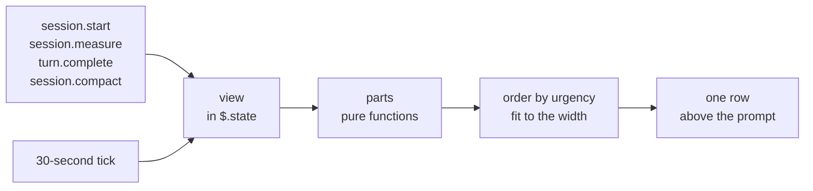

# Runway

One band above the Claude Code prompt that shows how much runway a session has left: the 5-hour and
7-day usage limits, the context window and the prompt cache, with the session cost and the agents
that run.

```
5h ▰▰▰▱▱▱▱▱ 36% 2h30m │ 7d ▰▰▱▱▱▱▱▱ 20% 5d │ ctx 80k 40% ▁▃▅▆█ +20k ~6 left │ cache 52m │ ≈ $2.08 (+$0.58 · +1.5% 5h) │ 2 agents running
```

The part that ends soonest comes first. When the window is narrow, the least urgent parts are
dropped whole, so the band is always one row.

## The parts

| Part | What it shows |
| --- | --- |
| `5h`, `7d` | The share of the limit that is used, as a bar and a percentage, then the time until the limit resets. |
| `ctx` | The tokens in the context and the share of the window. Then a chart of the context after each of the last 8 prompts, what the last prompt added, and how many prompts fit before the window is full. |
| `cache` | The time before the prompt cache goes cold. After that, the next message writes the whole context again, which uses much more of your limit. |
| Cost | The session cost, as `/cost` totals it. In brackets: what the last prompt added, in dollars and in points of the 5-hour limit. `≈` means an account with usage limits, where the figure is what the API would charge and not a bill. |
| Agents | The number of agents that run now, and the total in this session. |

### The limit bar

The bar has 8 cells. A filled cell (`▰`) is a share that is used. The bar also knows how much of
the window's time has passed:

- An empty cell in green is time that passed and that you did not use: your margin.
- A filled cell in yellow or red is use ahead of the clock: you use the limit faster than time passes.

When your pace would reach the limit before it resets, the part adds `ends in 40m`: the time until
the limit ends at this pace. The forecast starts when one tenth of the window has passed and 5% is
used, because an early reading gives a wild pace.

### The states

| Part | Yellow | Red |
| --- | --- | --- |
| `5h` | The pace reaches the limit before the reset, or 90% is used | The limit is reached, or it ends in 30 minutes or less |
| `7d` | The same | The limit is reached, or it ends in 24 hours or less |
| `ctx` | 75% of the window, or 10 prompts left or less | 90% of the window, or 3 prompts left or less |
| `cache` | One sixth of its life is left, or the model changed | Cold |

The cache part can also say:

- `cache warm`: a turn runs, and each request renews the cache.
- `cache: model changed`: you changed the model with `/model`. A cache belongs to one model, so the
  next message writes the context again.
- `cache cold · 289k to rewrite`: the cache lapsed. The figure is the context that the next message
  writes again.
- `cache compacted`: the session was compacted. The next answer writes a new cache.
- `· 70% read`: less than 90% of the last turn's input came from the cache.

## Install

```
claude plugin marketplace add tmathura/claude-runway
claude plugin install runway@tmathura-runway
```

Or, at the prompt of a terminal session:

```
/plugin install runway --marketplace tmathura/claude-runway
```

It needs Claude Code 2.1.323 or later. The mod API is early access, so a later build can change it.

## What the figures are

- The limits, the context and the cost are the figures that Claude Code reports. They are the same
  as `/usage`, `/context` and `/cost` show.
- An account with no usage limits (an API key, Bedrock, Vertex) has no `5h` and `7d` parts.
- The life of the prompt cache is not reported. The mod takes 60 minutes on an account with usage
  limits and 5 minutes on any other, counted from the end of the last turn.
- The forecasts are estimates from the present pace. `~6 left` is the mean growth of the last
  prompts divided into the room that is left in the window. Claude Code compacts the session before
  the window is full, so the compaction comes some prompts earlier.
- A new session shows the limits that your last session saved, until its own first answer.
- `+1.5% 5h` is how far the 5-hour figure of your account moved since the end of the prompt before.
  What another session used in that time is in it, because Claude Code learns the limits only from
  an answer.
- After `/clear` the limits stay, and the context chart, the cache time and the last prompt's cost
  start again.

## Privacy

The mod only watches. Every hook passes its event on unchanged: the mod never changes, delays or
refuses anything, and it never sends a message.

It makes no network request and reads no file. It reads the figures that Claude Code gives it:
token counts, limits, cost, the model id, and the state of each agent. It does not read the text of
a prompt, an answer or a tool call.

It keeps the latest limits reading in the plugin's local storage, so that a new session can show
it. It keeps the view of the present session (the figures above and the context size after each of
the last 8 prompts) in the session's memory only.

## How it works



The files under `hooks/lib/` are pure functions, tested with `node --test` from the repo root.
`hooks/runway.ts` is the only file that calls Claude Code.

## Credits and license

The idea of one band with the limits against the clock, the prompt cache and the cost follows
`token-weather-usage` by Eric Cologni ([augiefra/claude-mods](https://github.com/augiefra/claude-mods),
Apache-2.0). No code was copied. Apache-2.0 license: see
[LICENSE](https://github.com/tmathura/claude-runway/blob/main/LICENSE) and
[NOTICE](https://github.com/tmathura/claude-runway/blob/main/NOTICE).
